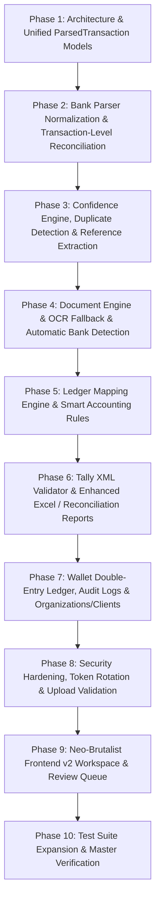

# Sheet Buddy — Upgrade Audit & Production Hardening Plan

**Date**: September 2026  
**Auditor**: Lead Systems Architect  
**Branch**: `v2-master-upgrade`  
**Baseline Version**: Sheet Buddy 1.0 (Production)

---

## 1. Existing Architecture & Inventory

### 1.1 Backend (`backend/`)
- **Framework**: FastAPI (async ASGI) on Python 3.13 / 3.10+
- **Entrypoint**: `backend/app/main.py`
- **Routing**:
  - `backend/app/api/auth.py`: JWT login, registration, password management, OTP recovery.
  - `backend/app/api/convert.py`: PDF upload, parsing preview, Tally XML generation, Excel export, history.
  - `backend/app/api/wallet.py`: Pricing packages, WhatsApp payment ticket registration, promo code redemption.
  - `backend/app/api/admin.py`: KPI overview, user management, credit adjustment, promo code management, payment ticket approval/rejection.
  - `backend/app/api/support.py`: Customer support ticket creation and listing.
- **Data Models** (`backend/app/models/models.py`):
  - `User`: `id`, `email`, `hashed_password`, `page_credits`, `is_admin`, `is_verified`.
  - `Conversion`: `id`, `user_id`, `bank_name`, `statement_period`, `account_number`, `pages_count`, `transactions_count`, `file_fingerprint`.
  - `WalletTransaction`: `id`, `user_id`, `amount_in_inr`, `pages_purchased`, `type`, `status`.
  - `BankConfig`: `id`, `bank_key`, `name`, `match_patterns`, `parser_type`, `config_json`.
  - `SupportQuery`: `id`, `user_id`, `subject`, `description`, `whatsapp_number`.
  - `PromoCode`: `id`, `code`, `credits`, `type`, `is_active`, `expires_at`.
  - `UserOTP`: `id`, `email`, `otp_code`, `purpose`, `expires_at`.
- **Parsers** (`backend/app/parsers/`):
  - `base.py`: `BankParser` abstract base class, `StandardTransaction`, `StatementMetadata`, `reconcile_statement`.
  - `sbi.py`: State Bank of India coordinate-based parser.
  - `__init__.py`: `BOBParser`, `AxisParser`, `GenericSimulatorParser`, `RuleBasedParser`, and dynamic parser factory `get_parser`.
- **Services** (`backend/app/services/`):
  - `xml_generator.py`: Tally XML generation for `Receipt` and `Payment` vouchers.
  - `excel_exporter.py`: OpenPyXL spreadsheet generation.
- **Core Utilities** (`backend/app/core/`):
  - `security.py`: Password hashing, JWT token generation & validation.
  - `config.py`: Environment variables & settings.
  - `email_utils.py`: Resend API / SMTP notification engine.

### 1.2 Frontend (`frontend/`)
- **Stack**: React 18, Vite 8.x, Tailwind CSS Play CDN & utility styling.
- **UI System**: Neo-Brutalist design (solid `#000000` borders, `shadow-[4px_4px_0px_rgba(0,0,0,1)]`, `#FFD629` brand yellow, zero border-radii).
- **Architecture**: Single-page application orchestrator inside `frontend/src/App.jsx` with tabs:
  - `convert`: Statement upload, preview table, inline narration editing, XML/Excel download.
  - `history`: Historical conversions search and cached XML re-downloads.
  - `wallet`: Pricing packs, UPI QR code modal, WhatsApp verification, promo code redemption, wallet activity log.
  - `support`: Support tickets and direct WhatsApp/Email actions.
  - `settings`: Password management and profile information.
  - `admin`: KPI cards, promo code generator, user management, global conversion logs, payment approval queue, support query resolution, bank config editor.

---

## 2. Technical Debt & Identified Gaps

| Area | Current Implementation | Limitation / Risk | Target v2 Upgrade |
| :--- | :--- | :--- | :--- |
| **Bank Detection** | User must manually select bank from dropdown | Manual human error if user selects wrong bank | Multi-signal Automatic Bank Detection with confidence score |
| **Transaction Schema** | Minimal `StandardTransaction` (7 fields) | Missing UTR, reference, type, confidence, category, ledger, status | Unified `ParsedTransaction` with 25+ accounting attributes |
| **Reconciliation** | Statement-level only ($Opening + Cr - Dr = Closing$) | Does not pinpoint specific broken transaction rows | Transaction-level running balance reconciliation ($Pass/Warning/Fail$) |
| **Confidence Scoring** | None (Binary Success/Failure) | No quality indicator for scanned or noisy PDFs | 0–100 Multi-metric extraction confidence engine |
| **Review Queue** | Raw table preview only | Hard for accountants to locate 4 error rows out of 1,000 | Structured Issue Review Queue with step-by-step diagnostic modal |
| **Duplicates** | File-level hash check only | Does not detect duplicate rows within or across statements | Fuzzy & exact transaction duplicate detection engine |
| **Ledger Mapping** | Hardcoded `Suspense Account` counter-ledger | Accountant must manually edit hundreds of vouchers in Tally | Configurable Rule-based Accounting & Smart Ledger Suggestion Engine |
| **Document Engine** | `pypdf` / `pdfplumber` direct call | Fails on scanned/image-only statement PDFs | Hybrid Document Engine with OCR fallback pipeline |
| **Tally Validation** | Direct string interpolation / basic templating | No pre-download schema validator | Strict Tally XML Schema & Voucher validation engine |
| **Wallet Audit** | Basic record table | No `balance_before`, `balance_after`, or row-locking | Double-entry ledger audit records with atomic locking |
| **Multi-Tenancy** | Single User $\leftrightarrow$ Conversions | Accounting firms manage hundreds of distinct clients | Multi-tenant Organization & Client Workspace architecture |
| **Security & Auth** | Single JWT access token | 365-day access token lacks revocation capabilities | Access + Refresh token pair with rotation and blacklisting |

---

## 3. Baseline Test Suite Status

```text
Platform: Windows (Python 3.13)
Ran: python -m pytest tests (inside backend/)
Result: 7 passed, 0 failed (373 deprecation warnings regarding datetime.utcnow and Pydantic v1 config)
Frontend Build: npm run build (0 errors, 539ms)
```

---

## 4. Phased Implementation Roadmap



---

## 5. Risk Assessment & Mitigation Matrix

| Change | Risk Level | Mitigation Strategy |
| :--- | :---: | :--- |
| **Transaction Schema Expansion** | Low | Inherit from / alias `StandardTransaction` fields for 100% backward compatibility. |
| **Parser Output Normalization** | Medium | Maintain existing parser logic while augmenting with UTR regexes and confidence calculators. |
| **Database Schema Additions** | Low | Add new tables (`ledger_rules`, `audit_logs`, `organizations`, `clients`) without altering existing column names. |
| **Tally XML Engine** | High | Strictly preserve XML tags, date format (`YYYYMMDD`), `ISDEEMEDPOSITIVE` signs, and test with unit tests. |
| **Authentication Upgrade** | Medium | Support both legacy bearer tokens and new refresh token rotation. |
| **Frontend UI Enhancements** | Low | Retain Neo-Brutalist theme (`#FFD629`, `#000000`, 4px shadows, sharp edges) and build upon existing React SPA components. |
