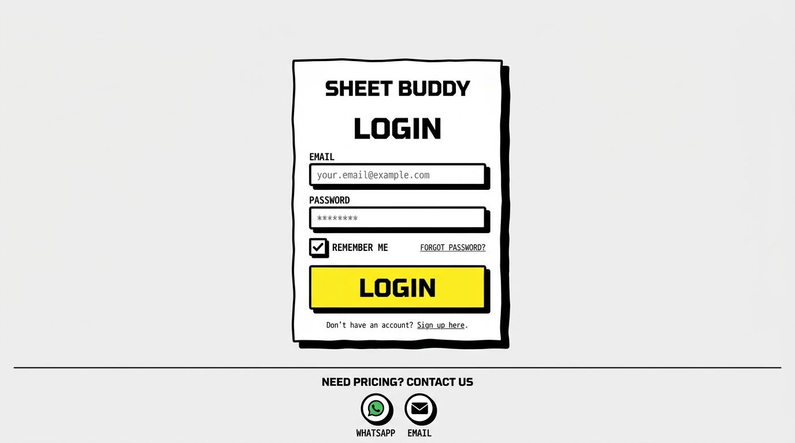
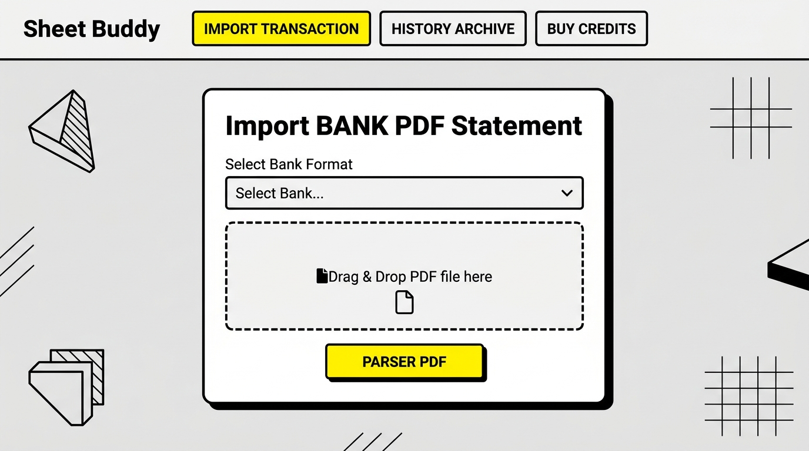
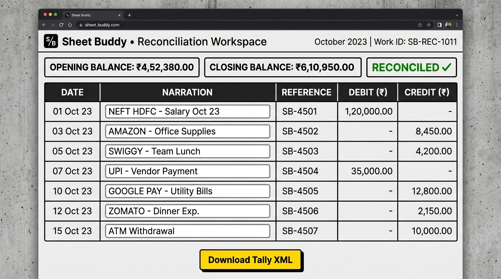

# Sheet Buddy - End-User Manual

Welcome to the **Sheet Buddy User Manual**! This guide takes you step-by-step through all features of the Sheet Buddy SaaS application to help you convert your Bank Statement PDF files into compliant Tally Prime XML import packages.

---

## 📑 Table of Contents
1. [Logging In and Keeping Sessions Active](#1-logging-in-and-keeping-sessions-active)
2. [Uploading Bank PDF Statements](#2-uploading-bank-pdf-statements)
3. [Reconciliation & Editing Vouchers](#3-reconciliation--editing-vouchers)
4. [Downloading and Importing XML into Tally Prime](#4-downloading-and-importing-xml-into-tally-prime)
5. [Viewing Conversion History](#5-viewing-conversion-history)
6. [Managing Credits and Contacting Support](#6-managing-credits-and-contacting-support)

---

## 1. Logging In and Keeping Sessions Active

Sheet Buddy uses a secure login gateway. Your account is pre-registered by the administrator.

### Steps to Log In:
1. Enter your registered **Email Address** and **Password** in the fields.
2. If you want to stay logged in across browser sessions without being automatically signed out, check the **Remember Me** checkbox. This preserves your token session for **365 days**.
3. Click the yellow **LOGIN** button.

---

## 2. Uploading Bank PDF Statements

Once logged in, you will be taken to the **IMPORT TRANSACTION** tab.

### Steps to Import:
1. Locate the **Import BANK PDF Statement** card.
2. Select your bank statement format from the **Select Bank Statement Format** dropdown (e.g., SBI, HDFC, ICICI, etc.).
3. Click inside the dashed rectangle or drag-and-drop your bank statement PDF file into the upload zone.
4. Verify the correct filename is shown, then click the yellow **PARSE STATEMENT PDF** button.

---

## 3. Reconciliation & Editing Vouchers

After parsing the statement PDF, Sheet Buddy processes the coordinates and loads your transactions into the **Reconciliation Workspace**.

### Features of the Workspace:
- **Balance Math Validation**: Sheet Buddy reads the opening and closing balances and asserts:
  $$\text{Opening Balance} + \text{Total Credits} - \text{Total Debits} == \text{Closing Balance}$$
  If the calculations match, a green **RECONCILED ✓** badge appears. If they mismatch, a warning banner is shown.
- **Editable Narration**: The narration column features live input boxes. If you want to change any narration before exporting, simply click the text box, modify the narration, and Sheet Buddy will use the new text.

---

## 4. Downloading and Importing XML into Tally Prime

Once you have verified your transactions in the Reconciliation Workspace:

1. Click the yellow **Download Tally XML** button at the bottom of the table.
2. Save the generated `.xml` file to your computer.

### Steps to Import into Tally Prime:
1. Open your Company ledger inside **Tally Prime**.
2. Go to the top menu bar or dashboard and select **Import** (Shortcut: `Alt + O`).
3. Click on **Transactions**.
4. In the file path prompt, select the path where you saved the Sheet Buddy XML file (e.g., `excel_tally_import.xml` or `Tally_Import_...xml`).
5. Hit enter to import. All transactions (Payments and Receipts) will be written directly into your journal books!

---

## 5. Viewing Conversion History

Need to re-download a past statement conversion? Click the **HISTORY ARCHIVE** tab in the main header.

- A comprehensive grid shows all past statement conversions with dates, bank names, statement periods, and total transactions processed.
- Click the **Download XML** button next to any past conversion to retrieve the XML package instantly without consuming any additional wallet credits.

---

## 6. Managing Credits and Contacting Support

- **Page Credits**: The top-right header displays your remaining credits. If you parse a statement, your credit balance is reduced by the number of pages in the statement.
- **Top-up Wallet**: Click the **BUY CREDITS** tab to choose a credit bundle (e.g., Starter, Professional, Enterprise) and purchase credits.
- **Support & Inquiries**: For pricing questions, custom demo booking, or any support, use the contact links in the footer at the bottom of the screen. You can click the **WhatsApp** or **Email** icons to directly connect with our customer support channels.
